<div align="center">

<picture>
  <source media="(prefers-color-scheme: dark)" srcset="docs/assets/wordmark.dark.svg">
  
</picture>

<sub>agent-loadout</sub>

### Claude Code, fully set up in one command.

The best plugins, MCP servers and rules, preconfigured to work together, on every machine, and kept up to date.

[](https://github.com/jonasyr/agent-loadout/actions/workflows/ci.yml)
[](LICENSE)
[](docs/tutorials/getting-started.md)
[](.claude-plugin/marketplace.json)

**[Quick start](#quick-start) · [What you get](#what-you-get) · [Toolset](#the-toolset) · [Trust](#why-you-can-trust-it) · [Docs](#docs)**

</div>


<sub>The Quick start below, on a machine that already has Claude Code. Recorded in a sandbox with fake data.</sub>

Claude Code gets much better with the right plugins, MCP servers and instructions, but setups drift: every machine ends up different, old tools linger and versions go stale. loadout is a reviewed shared kit (this repo) plus your [personal layer](docs/how-to/personal-repo.md) (your own folder, ideally a private git repo); its CLI merges both into `~/.claude` and keeps them current ([how it works](docs/explanation/architecture.md)).

## Quick start

You need git and curl; you log in to Claude Code and gh at the end. The one line per OS is in [Before you start](docs/tutorials/getting-started.md#before-you-start).

> [!NOTE]
> On Windows, use WSL 2 and read [Use loadout on Windows with WSL 2](docs/how-to/wsl.md) first. Start in your Linux home folder: a shell started from Windows opens in `/mnt/c`.

### 1. Install

Both ways do the same: they put the kit in an `agent-loadout` folder and run its setup.

**Quickest: one command** (clones into your home folder)

```bash
cd ~
curl -fsSL https://raw.githubusercontent.com/jonasyr/agent-loadout/main/bootstrap.sh | bash -s -- --install
```

**Or clone it yourself** (you choose the folder and can read the code first)

```bash
git clone https://github.com/jonasyr/agent-loadout
cd agent-loadout
./bootstrap.sh --install
```

Keep the folder where it is: the installed links point into it.

Bootstrap's first question is your personal layer, the folder for your own preferences and tools: paste the URL of your private repo for it, or press Enter for a starter you can [turn into one later](docs/how-to/personal-repo.md).

<details>
<summary>What the installer does</summary>

It installs what is missing, in your home folder and without sudo: uv (which also provides Python), Claude Code, Node.js, gh and every tool in [the toolset](#the-toolset). It never replaces a tool you already have. `--install` runs those installers without a further prompt ([what runs when you ask](docs/explanation/security-and-trust.md#what-runs-when-you-ask)). The one-liner clones into `./agent-loadout`; to choose another folder, add `--dir PATH` after the `--`, for example `bash -s -- --install --dir ~/tools/agent-loadout`.

Then it walks you through three steps (your personal layer, preferences, your existing setup) and, if it replaced anything, names the undo command. It ends with the steps still open on your machine. Step by step: [Getting started](docs/tutorials/getting-started.md).

</details>

<details>
<summary>Experimental: native Windows (not recommended; use WSL 2)</summary>

```powershell
cd $HOME
& ([scriptblock]::Create((irm https://raw.githubusercontent.com/jonasyr/agent-loadout/main/bootstrap.ps1))) --install
```

Git for Windows is required (Git Bash runs the hooks). Details: [Native Windows](docs/tutorials/getting-started.md#experimental-native-windows).

</details>

### 2. Log in

Open a new terminal (bootstrap added `~/.local/bin` to your shell profile), then:

```bash
claude                                  # log in to Claude Code, then quit it
gh auth login && gh auth setup-git      # log in to GitHub
```

### 3. Check

```bash
loadout check
```

A read-only health check: it prints `Health check: N of M OK` and names the fix for each problem.

### 4. Use it in a project

```bash
cd my-project
loadout init
```

Then open Claude Code there and run `/loadout:onboard`: it reads the project and writes its documentation.

## What you get

- **Curated defaults.** The toolset complements itself instead of overlapping, and every keep or drop decision has a written reason in [`catalog.json`](catalog.json).
- **Works on existing setups.** `loadout adopt` shows what it would change and why, asks first, and backs up what it replaces ([your own tools](docs/how-to/your-own-tools.md)).
- **Stays up to date by itself.** Claude Code updates the plugins, loadout pulls the kit and your personal layer daily, and you get a notice when tools have updates ([the daily sync](docs/explanation/architecture.md#the-daily-sync)).
- **Yours on top.** Your preferences, own tools and profiles live in your personal layer, ideally a private git repo, so they follow you to every machine ([set it up](docs/how-to/personal-repo.md)); change them with `loadout configure` or `/loadout:configure` ([preferences](docs/how-to/set-preferences.md)).
- **Codex too.** Turn on Codex and it gets the same rules, tools and preferences, kept current the same way ([Use loadout with Codex](docs/how-to/codex.md)).
- **Projects too.** `loadout init` prepares any repo for agent work, profiles add domain tools only where needed, and three skills keep the docs true ([documentation strategy](docs/explanation/documentation-strategy.md)).

## The toolset

One workflow from idea to merged change: Claude plans before it builds, works with a code graph, current docs and a real browser, and ends every change with a review and docs that are still true.

<picture>
  <source media="(prefers-color-scheme: dark)" srcset="docs/diagrams/toolset-workflow.dark.svg">
  
</picture>

<sub>[Source](docs/diagrams/toolset-workflow.mmd)</sub>

| Job | Tools | Kind |
|---|---|---|
| Plan before building | [superpowers](https://github.com/obra/superpowers) (brainstorm, plan, test-driven build, debug, verify) · `/loadout:execution-advisor` (inline or subagents, per task) | plugin · loadout skill |
| Understand the code | [codebase-memory-mcp](https://github.com/DeusData/codebase-memory-mcp) (code graph: callers, impact, dead code) · [Serena](https://github.com/oraios/serena) (find, rename, edit symbols) · LSP plugins for [Python](https://github.com/microsoft/pyright), [TypeScript](https://github.com/typescript-language-server/typescript-language-server), [Rust](https://github.com/rust-lang/rust-analyzer) (type errors after each edit) | MCP servers · plugins |
| Current docs | [Context7](https://github.com/upstash/context7) (libraries and frameworks) · [Microsoft Learn](https://github.com/MicrosoftDocs/mcp) (.NET, Azure, Windows) | MCP servers via plugins |
| UI that looks designed | [frontend-design](https://github.com/anthropics/claude-plugins-official/tree/main/plugins/frontend-design) (direction) · [playwright-cli](https://github.com/microsoft/playwright-cli) (real browser checks) · [impeccable](https://github.com/pbakaus/impeccable) (audit and polish) | plugins · CLI |
| Safe, documented changes | [security-guidance](https://github.com/anthropics/claude-plugins-official/tree/main/plugins/security-guidance) (warnings and commit review) · `/loadout:docs-sync`, `/loadout:docs-audit`, `/loadout:onboard` (docs that match the code) · [commit-commands](https://github.com/anthropics/claude-plugins-official/tree/main/plugins/commit-commands) (commit, push, PR) | plugins · loadout skills |
| Fewer tokens | [rtk](https://github.com/rtk-ai/rtk) (compact command output, applied by a hook) | CLI |

Domain tools (research, databases, SonarQube, Android) are added per project with profiles. How the pieces work together: [The toolset](docs/explanation/the-toolset.md). Every tool with its settings: [Included tools](docs/reference/included-tools.md).

## Why you can trust it

- **It updates itself, so you trust this repo.** A daily background job runs `git pull --ff-only` on this repo and your personal layer, and the next session runs the new code. Turn it off with `LOADOUT_NO_AUTO_PULL=1`, or point your clone at a fork you review ([the daily sync](docs/explanation/architecture.md#the-daily-sync)).
- **What it replaces can be restored.** Before loadout removes or replaces a tool, file or link you own, it moves it into a timestamped backup, and `loadout restore` puts it back. The routine sync of the kit's own settings is not backed up ([details](docs/how-to/undo-and-restore.md#what-restore-does-not-undo)).
- **Your tools never change without your answer.** `loadout adopt` is a dry run until `--apply`, then asks per group and once more before it applies; tools loadout does not know stay as they are, and binary updates show each command and ask first.
- **Secrets stay out of git.** Keys live in `~/.config/loadout/secrets.env` (readable only by you) and configs refer to them as `${VAR}`; your own tools recorded into your personal layer pass a secret guard (values you set with `configure set pref` are not checked; [secrets](docs/explanation/security-and-trust.md#secrets)).

What runs automatically and where the trust boundary is: [Security and trust](docs/explanation/security-and-trust.md). To report a vulnerability, see [SECURITY.md](SECURITY.md).

## Docs

The full index is [docs/README.md](docs/README.md).

| I want to | Read |
|---|---|
| Install step by step, per platform | [Getting started](docs/tutorials/getting-started.md) |
| Decide what happens to tools I already have | [Handle your own tools](docs/how-to/your-own-tools.md) |
| Undo something loadout changed | [Undo what loadout changed](docs/how-to/undo-and-restore.md) |
| Change my preferences or add tools globally | [Set your working preferences](docs/how-to/set-preferences.md) |
| Set up Codex the same way | [Use loadout with Codex](docs/how-to/codex.md) |
| Use my preferences and own tools on every machine | [Keep your personal layer in a private git repo](docs/how-to/personal-repo.md) |
| Add domain tools to one repo | [Write a personal profile](docs/how-to/write-a-profile.md), [Profile format](docs/reference/profile-format.md) |
| Fix a problem | [Troubleshooting](docs/how-to/troubleshooting.md) |
| Look up a command, flag or exit code | [CLI reference](docs/reference/cli.md) |
| See which tools are included and why | [Included tools](docs/reference/included-tools.md) |
| See how the tools form one workflow | [The toolset](docs/explanation/the-toolset.md) |
| Understand how the parts fit together | [Architecture](docs/explanation/architecture.md) |
| Know why it was built this way | [Decision records](docs/adr/README.md) |
| Remove loadout | [Uninstall loadout](docs/how-to/uninstall.md) |
| Contribute | [CONTRIBUTING.md](CONTRIBUTING.md) |

Gemini CLI and Cursor are not supported yet; how Codex is set up and how others could follow is in [Architecture](docs/explanation/architecture.md#codex-and-other-agents).

## Contributing

Contributions are very welcome. Please read [CONTRIBUTING.md](CONTRIBUTING.md) first and follow it: it covers setup, tests, the documentation rules and how to open a pull request. Everyone taking part follows the [Code of Conduct](CODE_OF_CONDUCT.md).

## License

[MIT](LICENSE)
